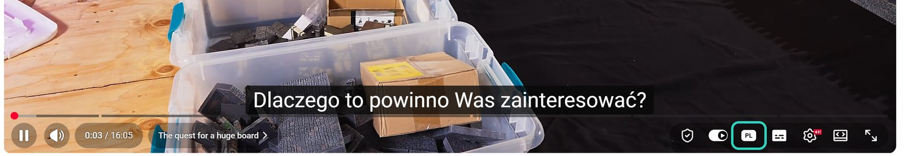
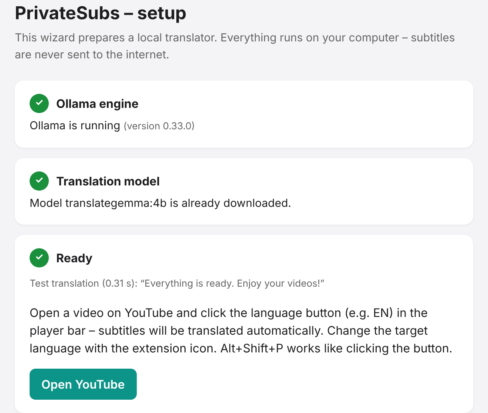
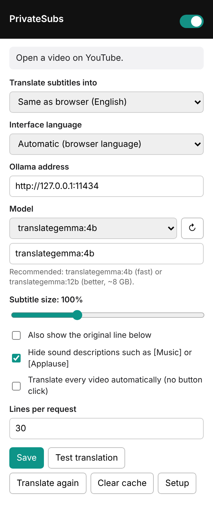
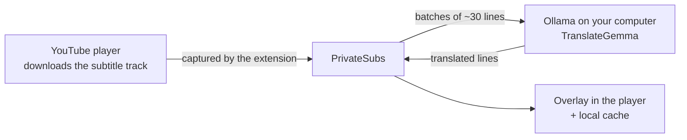

<p align="center">
  
</p>

<h1 align="center">PrivateSubs</h1>

<p align="center">
  <b>Translate YouTube subtitles into your language with a local AI model.<br>Nothing leaves your computer.</b>
</p>

<p align="center">
  <a href="https://github.com/wojciechkaluzny-ctrl/privatesubs/releases/latest"></a>
  <a href="LICENSE"></a>
  
  
  
</p>

<p align="center">
  <a href="README.pl.md">🇵🇱 Polska wersja</a>
</p>

<p align="center">
  <a href="https://github.com/wojciechkaluzny-ctrl/privatesubs/releases/latest/download/privatesubs.zip"><b>⬇️ Download the latest version (ZIP)</b></a>
  &nbsp;·&nbsp; <a href="https://github.com/wojciechkaluzny-ctrl/privatesubs/releases">All releases</a>
</p>

---

## Installation (about 5 minutes)

1. **[Download `privatesubs.zip`](https://github.com/wojciechkaluzny-ctrl/privatesubs/releases/latest/download/privatesubs.zip)** (always the latest version) and extract it to a folder you'll keep.
   The browser loads the extension from this folder, so don't delete it.
2. Open the extensions page and turn on **Developer mode**:

   | Browser | Address | Developer mode switch |
   |---|---|---|
   | Chrome | `chrome://extensions` | top right |
   | Edge | `edge://extensions` | left panel |
   | Opera | `opera://extensions` | top right |

3. Click **Load unpacked** and select the extracted folder (the one with `manifest.json`).
4. The **setup wizard** opens by itself. It installs [Ollama](https://ollama.com) (a free app that runs AI models locally)
   and downloads the translation model (≈3.3 GB) with a progress bar.
5. Open a YouTube video with subtitles and click the language button (e.g. **EN**) next to the CC button. That's it.

- **Updating:** download the ZIP again, replace the files in the same folder, then click the reload icon on the extension card.
- **From source:** `git clone https://github.com/wojciechkaluzny-ctrl/privatesubs.git` and load the `extension/` folder.

Requirements and details are in the [Requirements](#requirements) section below.

---

Many YouTube videos only have English subtitles, and YouTube's own auto-translate isn't available everywhere.
**PrivateSubs** adds a language button to the YouTube player. One click translates the whole subtitle track with an AI model
running **on your own computer** through [Ollama](https://ollama.com). It doesn't use cloud APIs, API keys or accounts, and nobody sees what you watch.

<p align="center"></p>

<p align="center">
  
  &nbsp;
  
</p>

## Features

- **One-click button in the player.** The button next to the CC icon shows your target language (`PL`, `EN`, `DE`…) and switches translation for the current video.
- **Whole video at once.** PrivateSubs reads the complete subtitle track and starts with the part you're watching. The rest is translated in the background, and translation follows you when you seek.
- **Any source language → ~40 target languages.** The target defaults to your browser's language and can be changed in the popup.
- **Readable auto-generated captions.** Word-by-word speech-recognition captions are merged into proper sentences before translation, which noticeably improves quality.
- **Remembers your choice per video.** Come back to a video and translation is on again, loaded instantly from the local cache.
- **Setup wizard.** It downloads the Ollama installer, detects when Ollama is running and downloads the translation model with a progress bar. You don't need a terminal.
- **Leaves subtitles already in your language alone.** If the video already has subtitles in your target language, YouTube's own captions are shown.
- **Works full screen.** Subtitle size is adjustable, and you can optionally show the original line under the translation.
- **Keyboard shortcut:** `Alt+Shift+P` toggles translation on the current video.
- **Interface in English and Polish.** It follows your browser's language by default, and you can change it in the popup.

## How it works



When you turn captions on, the YouTube player downloads the whole subtitle track in one request. PrivateSubs captures that response
inside the page, so it doesn't need to call YouTube itself. It sends the lines to Ollama on `127.0.0.1` and draws the translated subtitles over the player.
See [docs/how-it-works.md](docs/how-it-works.md) for the details.

## Requirements

| | |
|---|---|
| **Browser** | Chrome, Edge, Opera, Brave, Vivaldi or another Chromium-based browser (Manifest V3) |
| **Ollama** | Free app for running AI models locally – the setup wizard installs it ([ollama.com](https://ollama.com)) |
| **Model** | `translategemma:4b` (≈3.3 GB, default) or `translategemma:12b` (≈8 GB, better quality) |
| **Hardware** | 4B runs on most computers, GPU recommended. 12B needs a graphics card with about 12 GB of memory |
| **OS** | Windows, macOS, Linux (on Linux, Ollama is installed with one terminal command) |

## Usage

1. Open a YouTube video with subtitles.
2. Click the language button (e.g. **EN**) in the player bar, next to the CC button.
3. Subtitles appear in your language within a few seconds. While translation runs, a thin progress bar sits under the button.
4. Click the button again to go back to the original subtitles.

| Button | Meaning |
|---|---|
| outline | translation off for this video |
| filled white | translation on |
| progress bar underneath | translating |
| red | error (the message appears in the top-left corner of the player and in the popup) |

### Settings (extension icon)

| Setting | Description |
|---|---|
| Translate subtitles into | Target language. *Same as browser* by default |
| Interface language | Language of the extension itself (*Automatic*, English, Polski) |
| Ollama address | `http://127.0.0.1:11434` by default. Can point to another computer on your network |
| Model | Any model installed in Ollama |
| Subtitle size | Scales the translated subtitles |
| Also show the original line below | Dual subtitles, which is handy for language learning |
| Translate every video automatically | Turns translation on for every video without clicking the button |
| Lines per request | Batch size sent to the model (smaller is more robust, larger is faster) |
| Test translation / Translate again / Clear cache / Setup | Utilities |

## Models

| Model | Size | Notes |
|---|---|---|
| `translategemma:4b` | ≈3.3 GB | Default. Fast, good quality for major languages |
| `translategemma:12b` | ≈8 GB | Noticeably better, especially for less common languages |
| `translategemma:27b` | ≈17 GB | Best quality, needs a high-end GPU |
| any chat model (`gemma3`, `qwen3`, …) | – | Supported through a JSON mode that keeps the exact line count |

TranslateGemma is a family of open translation models from Google, built on Gemma 3. Models are downloaded by Ollama
and are covered by their own licenses.

### Ollama on another computer

You can run Ollama on a stronger machine on your network (or over a VPN such as Tailscale). On that machine set
`OLLAMA_HOST=0.0.0.0` and `OLLAMA_ORIGINS=*`, then enter its address in the popup, e.g. `http://192.168.1.10:11434`.
The browser will ask for permission to access that address.

## Privacy

- PrivateSubs has **no server, no analytics and no telemetry**.
- Subtitle text goes only to the Ollama address you configured (your own computer by default).
- Translations and settings are stored locally in the browser (`chrome.storage.local`).
- The only other network requests happen in the setup wizard: the Ollama installer from GitHub and the model from the Ollama library, both started by you.

Read the full [privacy policy](PRIVACY.md).

### Permissions

| Permission | Why |
|---|---|
| Access to `youtube.com` | Captures the subtitle track and shows the button and translated subtitles in the player |
| Access to `localhost` / `127.0.0.1` | Talks to Ollama |
| `storage`, `unlimitedStorage` | Settings and the translation cache |
| `declarativeNetRequest` | Removes the `Origin` header from requests to Ollama, so Ollama accepts them without extra configuration |
| `downloads`, `downloads.open` | Lets the setup wizard download and open the Ollama installer |
| optional: other hosts | Only if you point the extension to Ollama on another computer |

## Troubleshooting

| Problem | Solution |
|---|---|
| No language button in the player | Refresh the YouTube tab after installing or updating the extension |
| "Cannot connect to Ollama" | Ollama isn't running. Start it, or open the setup wizard |
| "Model … is not downloaded" | Open the setup wizard, or run `ollama pull translategemma:4b` |
| "Ollama refused the connection (403)" | Set `OLLAMA_ORIGINS=chrome-extension://*` and restart Ollama (Windows: `setx OLLAMA_ORIGINS "chrome-extension://*"`) |
| "This video has no subtitles to translate" | The video has no subtitles at all, not even auto-generated ones |
| Translation is slow | Use the 4B model, or run Ollama on a computer with a GPU |
| Lines get misaligned | Lower *Lines per request* to about 15 |

## Limitations

- The video needs subtitles of some kind (auto-generated ones are fine). Videos without subtitles would need speech recognition (e.g. Whisper), which isn't supported yet.
- PrivateSubs relies on how the YouTube player works internally, so a YouTube update may require an extension update.
- Subtitles don't show in picture-in-picture / pop-out video windows, because those display only the video itself.
- Firefox isn't supported yet.

## Development

```
extension/          the extension (load this folder unpacked)
  manifest.json
  hook.js           page context: captures the subtitle track downloaded by the player
  parse.js          json3/XML parsing, sentence rebuilding for auto-captions
  content.js        translation queue, cache, overlay, player button
  translator.js     Ollama client (TranslateGemma prompt / JSON mode for chat models)
  background.js     service worker: messaging, Origin-header rule, cache pruning
  popup.*  setup.*  settings popup and setup wizard
  _locales/         UI texts (en, pl)
tests/              unit + end-to-end tests (Playwright, mocked YouTube and Ollama)
scripts/            packaging and screenshot scripts
docs/               documentation and screenshots
```

```bash
npm install                 # installs Playwright (for end-to-end tests)
npx playwright install chromium
npm test                    # unit tests: parsing, translation alignment, locale files
npm run test:e2e            # loads the extension in Chromium against a fake YouTube page and a mock Ollama
npm run package             # dist/privatesubs-<version>.zip + dist/privatesubs.zip
npm run screenshots         # regenerates docs/screenshots
```

See [CONTRIBUTING.md](CONTRIBUTING.md), including how to add a new interface language.

## Roadmap

- [ ] Firefox version
- [ ] Publishing in the Chrome Web Store, Edge Add-ons and Opera add-ons
- [ ] Subtitles for videos without captions (local speech recognition)
- [ ] More interface languages
- [ ] Subtitle style options (position, colors)

## Acknowledgements

- [Ollama](https://ollama.com) for running models locally
- [TranslateGemma](https://ollama.com/library/translategemma) by Google, the default translation model

## Disclaimer

PrivateSubs is an independent project and isn't affiliated with or endorsed by YouTube or Google.
YouTube is a trademark of Google LLC.

## Author

[Wojciech Kaluzny](https://github.com/wojciechkaluzny-ctrl)

## License

[MIT](LICENSE)
