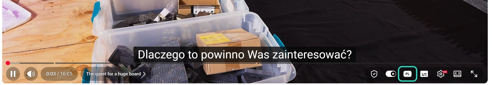
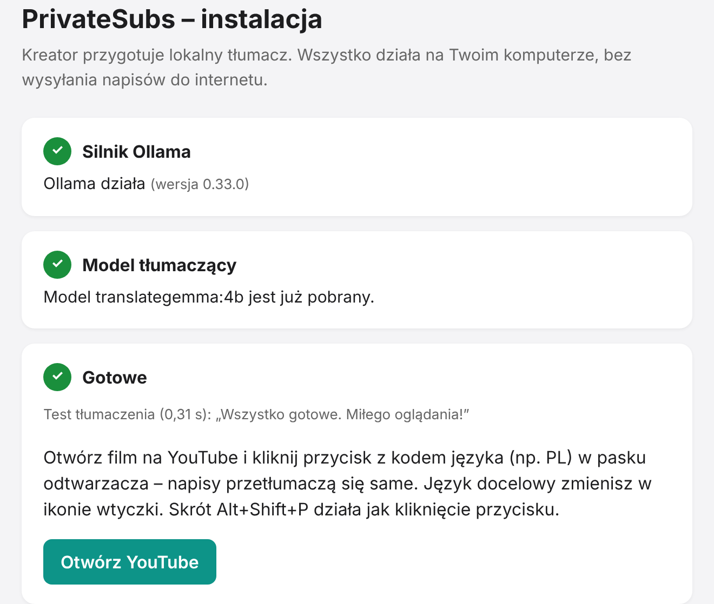
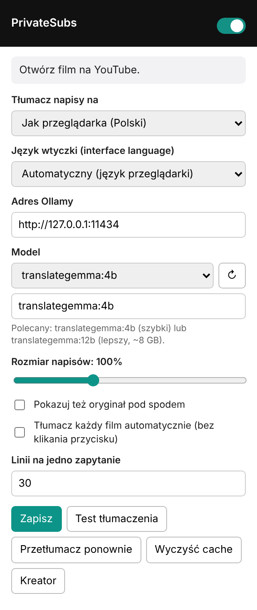
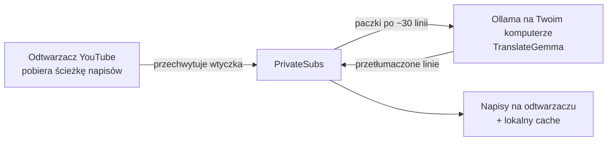

<p align="center">
  
</p>

<h1 align="center">PrivateSubs</h1>

<p align="center">
  <b>Tłumaczy napisy z YouTube na Twój język lokalnym modelem AI.<br>Nic nie opuszcza Twojego komputera.</b>
</p>

<p align="center">
  <a href="LICENSE"></a>
  
  
  
</p>

<p align="center">
  <a href="README.md">🇬🇧 English version</a>
</p>

---

Wiele filmów na YouTube ma tylko angielskie napisy, a automatyczne tłumaczenie YouTube nie zawsze jest dostępne.
**PrivateSubs** dodaje do odtwarzacza przycisk z kodem języka. Jedno kliknięcie tłumaczy całe napisy filmu modelem AI
działającym **na Twoim komputerze** przez [Ollamę](https://ollama.com). Wtyczka nie korzysta z chmury, kluczy API ani kont, więc nikt nie widzi, co oglądasz.

<p align="center"></p>

<p align="center">
  
  &nbsp;
  
</p>

## Funkcje

- **Przycisk w odtwarzaczu.** Obok ikony napisów pojawia się przycisk z kodem języka docelowego (`PL`, `EN`, `DE`…), który włącza i wyłącza tłumaczenie na danym filmie.
- **Cały film naraz.** Wtyczka pobiera całą ścieżkę napisów i zaczyna od fragmentu, który właśnie oglądasz. Reszta tłumaczy się w tle, a po przewinięciu kolejność się dostosowuje.
- **Dowolny język źródłowy → ok. 40 języków docelowych.** Domyślnie wtyczka tłumaczy na język przeglądarki. Zmienisz go w ikonie wtyczki.
- **Czytelne napisy automatyczne.** Napisy generowane z mowy, które przychodzą słowo po słowie, są składane w zdania przed tłumaczeniem, co wyraźnie poprawia jakość.
- **Pamięta wybór dla każdego filmu.** Po powrocie do filmu tłumaczenie włącza się samo, od razu z lokalnej pamięci podręcznej.
- **Kreator instalacji.** Pobiera instalator Ollamy, sam wykrywa jej uruchomienie i pobiera model z paskiem postępu. Terminal nie jest potrzebny.
- **Nie rusza napisów, które już są w Twoim języku.** Wtedy pokazuje oryginalne napisy YouTube.
- **Działa na pełnym ekranie.** Rozmiar napisów można regulować, a pod tłumaczeniem może się też pokazywać oryginał.
- **Skrót `Alt+Shift+P`** włącza i wyłącza tłumaczenie na bieżącym filmie.
- **Interfejs po polsku i angielsku.** Domyślnie według języka przeglądarki, a w okienku wtyczki możesz go zmienić.

## Jak to działa



Po włączeniu napisów odtwarzacz YouTube pobiera całą ścieżkę napisów jednym zapytaniem. PrivateSubs przechwytuje tę odpowiedź
wewnątrz strony, więc nie musi sam łączyć się z YouTube. Następnie wysyła linie do Ollamy pod adresem `127.0.0.1` i rysuje przetłumaczone napisy na odtwarzaczu.
Szczegóły znajdziesz w [docs/how-it-works.md](docs/how-it-works.md) (po angielsku).

## Wymagania

| | |
|---|---|
| **Przeglądarka** | Chrome, Edge, Opera, Brave, Vivaldi lub inna oparta na Chromium (Manifest V3) |
| **Ollama** | Darmowa aplikacja do uruchamiania modeli AI lokalnie, instaluje ją kreator ([ollama.com](https://ollama.com)) |
| **Model** | `translategemma:4b` (≈3,3 GB, domyślny) lub `translategemma:12b` (≈8 GB, lepsza jakość) |
| **Sprzęt** | Model 4B działa na większości komputerów, zalecana karta graficzna. Model 12B potrzebuje karty z ok. 12 GB pamięci |
| **System** | Windows, macOS, Linux (na Linuksie Ollamę instaluje się jedną komendą w terminalu) |

## Instalacja

### Z wydania (zalecane)

1. Pobierz `privatesubs-<wersja>.zip` ze strony [Releases](https://github.com/wojciechkaluzny-ctrl/privatesubs/releases).
2. Rozpakuj go do stałego folderu. Przeglądarka wczytuje wtyczkę z tego folderu, więc go nie usuwaj.
3. Wczytaj wtyczkę:

   | Przeglądarka | Kroki |
   |---|---|
   | Chrome | `chrome://extensions` → włącz **Tryb dewelopera** (prawy górny róg) → **Załaduj rozpakowane** → wskaż folder |
   | Edge | `edge://extensions` → włącz **Tryb dewelopera** (panel po lewej) → **Załaduj rozpakowane** → wskaż folder |
   | Opera | `opera://extensions` → włącz **Tryb dewelopera** → **Załaduj rozpakowane** → wskaż folder |

4. Sam otworzy się **kreator instalacji**, który przeprowadzi Cię przez instalację Ollamy i pobranie modelu.

### Ze źródeł

```bash
git clone https://github.com/wojciechkaluzny-ctrl/privatesubs.git
```

Potem **Załaduj rozpakowane** i wskaż folder `extension/`.

## Użytkowanie

1. Otwórz film na YouTube, który ma napisy.
2. Kliknij przycisk z kodem języka (np. **PL**) w pasku odtwarzacza, obok przycisku napisów.
3. Po kilku sekundach napisy pojawią się w Twoim języku. W trakcie tłumaczenia pod przyciskiem widać cienki pasek postępu.
4. Ponowne kliknięcie przywraca oryginalne napisy.

| Przycisk | Znaczenie |
|---|---|
| obrys | tłumaczenie wyłączone na tym filmie |
| wypełniony na biało | tłumaczenie włączone |
| pasek pod spodem | trwa tłumaczenie |
| czerwony | błąd (komunikat w lewym górnym rogu odtwarzacza i w okienku wtyczki) |

### Ustawienia (ikona wtyczki)

| Ustawienie | Opis |
|---|---|
| Tłumacz napisy na | Język docelowy. Domyślnie *Jak przeglądarka* |
| Język wtyczki | Język samej wtyczki (*Automatyczny*, English, Polski) |
| Adres Ollamy | Domyślnie `http://127.0.0.1:11434`. Może wskazywać inny komputer w sieci |
| Model | Dowolny model zainstalowany w Ollamie |
| Rozmiar napisów | Skala przetłumaczonych napisów |
| Pokazuj też oryginał pod spodem | Podwójne napisy, przydatne do nauki języków |
| Tłumacz każdy film automatycznie | Włącza tłumaczenie na każdym filmie bez klikania przycisku |
| Linii na jedno zapytanie | Ile linii trafia do modelu naraz (mniej to stabilniej, więcej to szybciej) |
| Test tłumaczenia / Przetłumacz ponownie / Wyczyść cache / Kreator | Narzędzia |

## Modele

| Model | Rozmiar | Uwagi |
|---|---|---|
| `translategemma:4b` | ≈3,3 GB | Domyślny. Szybki, dobra jakość dla popularnych języków |
| `translategemma:12b` | ≈8 GB | Wyraźnie lepszy, szczególnie dla rzadszych języków |
| `translategemma:27b` | ≈17 GB | Najlepsza jakość, wymaga mocnej karty graficznej |
| dowolny model czatowy (`gemma3`, `qwen3`, Bielik…) | – | Obsługiwany w trybie JSON, który pilnuje liczby linii |

TranslateGemma to rodzina otwartych modeli tłumaczeniowych Google'a, zbudowanych na Gemma 3. Modele pobiera Ollama
i obowiązują je ich własne licencje.

### Ollama na innym komputerze

Ollamę można uruchomić na mocniejszym komputerze w sieci domowej (lub przez VPN, np. Tailscale). Na tamtym komputerze ustaw
`OLLAMA_HOST=0.0.0.0` i `OLLAMA_ORIGINS=*`, a w wtyczce wpisz jego adres, np. `http://192.168.1.10:11434`.
Przeglądarka poprosi o zgodę na dostęp do tego adresu.

## Prywatność

- PrivateSubs **nie ma serwera, analityki ani telemetrii**.
- Tekst napisów trafia wyłącznie pod skonfigurowany adres Ollamy (domyślnie Twój własny komputer).
- Tłumaczenia i ustawienia są przechowywane lokalnie w przeglądarce (`chrome.storage.local`).
- Jedyne inne połączenia wykonuje kreator: pobiera instalator Ollamy z GitHuba i model z biblioteki Ollamy, w obu przypadkach na Twoje kliknięcie.

Pełna [polityka prywatności](PRIVACY.md).

### Uprawnienia

| Uprawnienie | Po co |
|---|---|
| Dostęp do `youtube.com` | Przechwytywanie ścieżki napisów, przycisk i napisy w odtwarzaczu |
| Dostęp do `localhost` / `127.0.0.1` | Połączenie z Ollamą |
| `storage`, `unlimitedStorage` | Ustawienia i pamięć tłumaczeń |
| `declarativeNetRequest` | Usuwa nagłówek `Origin` z zapytań do Ollamy, dzięki czemu Ollama je przyjmuje bez dodatkowej konfiguracji |
| `downloads`, `downloads.open` | Kreator pobiera i uruchamia instalator Ollamy |
| opcjonalnie: inne adresy | Tylko gdy wskażesz Ollamę na innym komputerze |

## Rozwiązywanie problemów

| Problem | Rozwiązanie |
|---|---|
| Brak przycisku w odtwarzaczu | Odśwież kartę YouTube po instalacji lub aktualizacji wtyczki |
| „Brak połączenia z Ollamą” | Ollama nie działa. Uruchom ją albo otwórz kreator |
| „Model … nie jest pobrany” | Otwórz kreator albo uruchom `ollama pull translategemma:4b` |
| „Ollama odrzuca połączenie (403)” | Ustaw `OLLAMA_ORIGINS=chrome-extension://*` i zrestartuj Ollamę (Windows: `setx OLLAMA_ORIGINS "chrome-extension://*"`) |
| „Ten film nie ma napisów do przetłumaczenia” | Film nie ma żadnych napisów, nawet automatycznych |
| Tłumaczenie trwa długo | Użyj modelu 4B albo uruchom Ollamę na komputerze z kartą graficzną |
| Linie się rozjeżdżają | Zmniejsz *Linii na jedno zapytanie* do ok. 15 |

## Ograniczenia

- Film musi mieć jakiekolwiek napisy (automatyczne też wystarczą). Filmy bez napisów wymagałyby rozpoznawania mowy (np. Whisper), czego wtyczka jeszcze nie robi.
- Wtyczka opiera się na wewnętrznym działaniu odtwarzacza YouTube, więc aktualizacja YouTube może wymagać aktualizacji wtyczki.
- Napisy nie pokazują się w okienku obraz w obrazie ani w wyskakującym okienku wideo, bo one wyświetlają tylko sam obraz.
- Firefox nie jest jeszcze obsługiwany.

## Rozwój

Strukturę projektu, testy i skrypty opisuje sekcja [Development](README.md#development) w angielskim README.
Jak dodać nowy język interfejsu, opisuje [CONTRIBUTING.md](CONTRIBUTING.md).

## Plany

- [ ] Wersja dla Firefoksa
- [ ] Publikacja w Chrome Web Store, Edge Add-ons i Opera add-ons
- [ ] Napisy dla filmów bez napisów (lokalne rozpoznawanie mowy)
- [ ] Więcej języków interfejsu
- [ ] Wygląd napisów (pozycja, kolory)

## Podziękowania

- [Ollama](https://ollama.com) za lokalne uruchamianie modeli
- [TranslateGemma](https://ollama.com/library/translategemma) od Google'a, domyślny model tłumaczący

## Zastrzeżenie

PrivateSubs to niezależny projekt, niepowiązany z YouTube ani Google'em.
YouTube jest znakiem towarowym Google LLC.

## Autor

[Wojciech Kaluzny](https://github.com/wojciechkaluzny-ctrl)

## Licencja

[MIT](LICENSE)
