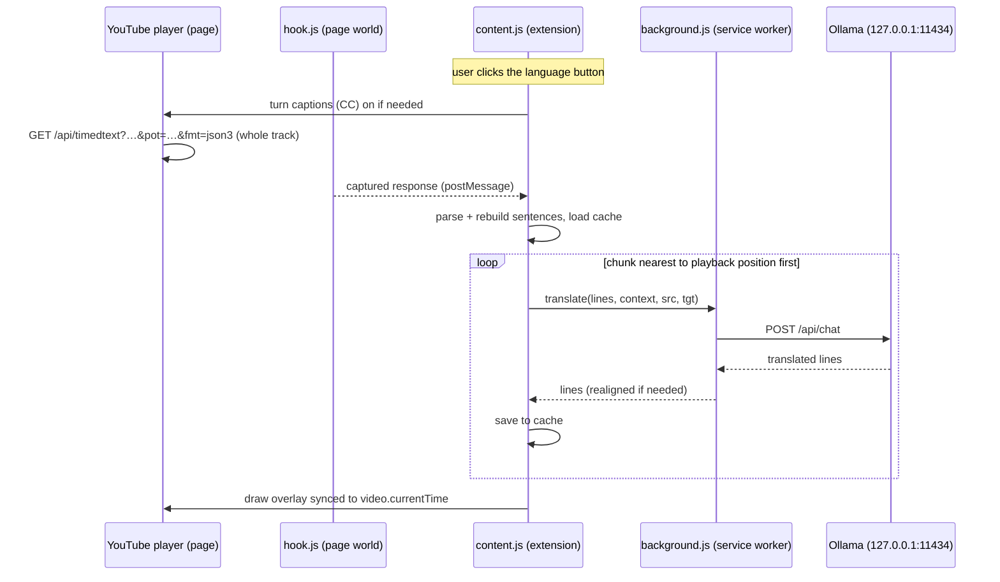

# How PrivateSubs works

## Overview

## 1. Getting the subtitles (`hook.js`)

YouTube's subtitle endpoint (`/api/timedtext`) now requires a *proof-of-origin token* (`pot`) that the player generates at runtime.
A plain request without it returns an empty response. Instead of fetching subtitles itself, PrivateSubs runs a small script in the
page context (`"world": "MAIN"`) that wraps `fetch` and `XMLHttpRequest`. When the player downloads the subtitle track, the script passes a copy
of the response to the extension with `window.postMessage`.

The player downloads the **entire track in one request**, so the extension has all subtitles of the video from the start.
As a fallback, a `PerformanceObserver` notices timedtext requests the hooks missed and fetches the exact same URL again (it already contains the token).
The last few captured tracks are kept, so a content script that starts late can ask for a replay.

Captions are only downloaded when CC is on. When you click the language button, the extension turns CC on for you.

## 2. Parsing (`parse.js`)

- `json3`, the player's format, plus XML `srv3`/`srv1` as a fallback.
- **Manual subtitles**: one cue per event.
- **Auto-generated subtitles** (`kind=asr`) arrive word by word in rolling two-line windows. The words are collected with absolute
  timestamps and regrouped into lines that end at sentence boundaries, at pauses longer than 1.5 s or after 90 characters.
  This makes them far easier to read and to translate.
- Cues are split into chunks of about 30 lines that end on a sentence boundary where possible.

## 3. Translating (`translator.js`, `background.js`)

The service worker sends each chunk to Ollama's `/api/chat`:

- **TranslateGemma models** get their native prompt (`You are a professional <src> to <tgt> translator…`)
  with one subtitle line per text line.
- **Other chat models** get a system prompt plus JSON input (`{"context": [...], "lines": [...]}`) and a JSON-schema
  `format` that forces exactly *n* output strings.

**Alignment guard.** If the model returns a different number of lines than it received (for example by merging two fragments of one sentence),
the batch is split in half and each half is translated again, recursively. Each translated line therefore always belongs to its original timing.

**Origin header.** Ollama rejects browser requests whose `Origin` it doesn't recognise, and `chrome-extension://…` isn't on its default list.
A `declarativeNetRequest` rule removes the `Origin` header from requests to the configured Ollama address, so no
`OLLAMA_ORIGINS` configuration is needed.

## 4. Scheduling and cache (`content.js`)

- The next chunk to translate is the one containing the current playback position, then the following ones, then whatever is left
  earlier in the video. Seeking changes the order immediately.
- Results are saved after every chunk under `c:<videoId>:<sourceLang>:<kind>:<targetLang>` in `chrome.storage.local`,
  together with the model name. A different model means a fresh translation. The cache is pruned to the newest 300 entries.
- The on/off choice per video is stored separately (`videoPrefs`, newest 500 videos).
- Any change of track (another caption language, YouTube's own auto-translate, a new target language) starts a new *session*.
  Results that arrive late from an older session are discarded.

## 5. Display (`content.js`, `overlay.css`)

- An overlay inside `#movie_player`, so it also works full screen. A `requestAnimationFrame` loop finds the current cue
  with a binary search on `video.currentTime`.
- YouTube's own caption window is hidden (not removed) while the overlay is active. Turning CC off hides both.
- Lines that aren't translated yet are shown in the original language, in grey italics.
- The language button is inserted before `.ytp-subtitles-button` and sized to match YouTube's icons, which differ between the old and new player UIs.
  A check every 400 ms re-inserts it if YouTube re-renders the controls.

## 6. Setup wizard (`setup.js`)

1. `GET /api/version`: is Ollama running?
2. If not: `chrome.downloads.download()` fetches `OllamaSetup.exe` / `Ollama.dmg` from the latest GitHub release.
   **Run the installer** calls `chrome.downloads.open()`, which must happen on a user click. The wizard keeps polling until Ollama answers.
   On Linux it shows the official one-line install command.
3. `POST /api/pull` streams progress per layer and shows the total. An interrupted download resumes on the next attempt.
4. A test translation warms up the model.

## Files

| File | Runs in | Purpose |
|---|---|---|
| `hook.js` | page (MAIN world) | capture the subtitle track |
| `defaults.js` | everywhere | default settings, language list, `ytplT()` i18n helper |
| `parse.js` | content script | subtitle parsing, chunking, cue lookup |
| `content.js` | content script | queue, cache, overlay, player button |
| `translator.js` | service worker | Ollama client, prompts, alignment |
| `background.js` | service worker | messaging, Origin rule, cache pruning, shortcut |
| `popup.*` | popup | status and settings |
| `setup.*` | tab | setup wizard |
| `i18n.js` | popup, setup | fills `data-i18n` texts |
